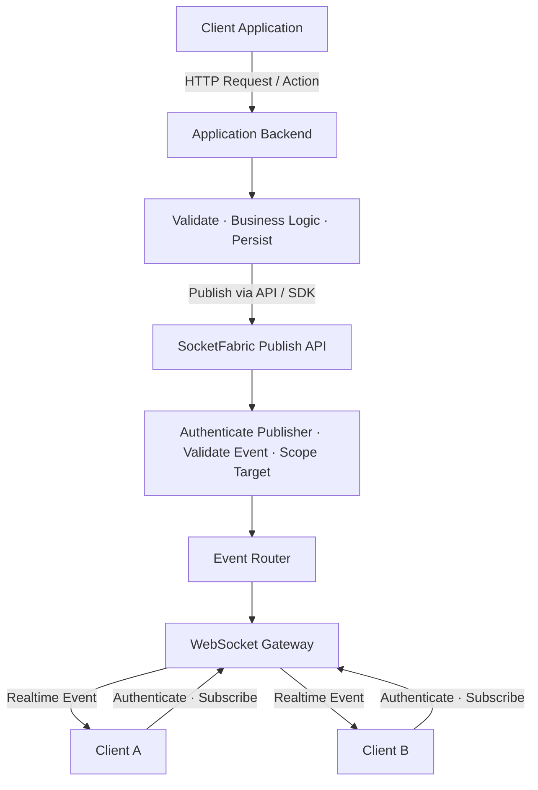
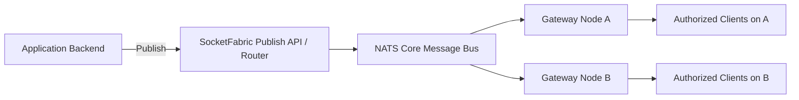

# SocketFabric — Project Context

> Status: **Phase 5D — Backend Readiness Gate & API Freeze**  
> Document type: Project context for coding agents and developers  
> Last updated: 2026-10-17  
> Product category: Self-hosted, framework-agnostic realtime infrastructure

## 1. Product Overview

**SocketFabric** คือระบบกลางสำหรับรับและกระจาย **Realtime Events** จาก Application Backend ไปยัง Client ที่เชื่อมต่อผ่าน WebSocket โดยไม่ให้แต่ละ Backend ต้องเขียนและดูแล Connection, Room, Subscription และ Event Routing เองซ้ำ ๆ

SocketFabric **ไม่ใช่** Business Backend, Database, ระบบเกม หรือ WebSocket protocol ใหม่ แต่เป็น **standalone realtime service** ที่ Backend ต่าง ๆ เรียกใช้งานผ่าน HTTP API หรือ SDK ได้

### Core value proposition

- แยก Realtime Connection Management ออกจาก Application Business Logic
- Publish Event ไปยัง **User / Room / Channel** ได้โดยไม่ต้องรู้ว่า Client เชื่อมต่อกับ Gateway Node ใด
- รองรับการขยายจาก Single-node ไปเป็น Distributed Gateway ในอนาคต
- ใช้ซ้ำได้ในหลาย Use Cases เช่น Notification, Chat, Live Dashboard, Collaboration และ Multiplayer โดย Core ไม่ผูกกับ Use Case ใด
- ให้ความสำคัญกับ Developer Experience, Security และ Delivery Semantics ที่อธิบายได้ชัดเจน

**Product hypothesis:** การใช้ SocketFabric ควรลดความซับซ้อนรวมในการสร้างและดูแล Realtime ของทีม มากกว่าการพัฒนา WebSocket ภายใน Backend เองหรือใช้ Library/Adapter ที่มีอยู่ ต้องพิสูจน์สมมติฐานนี้ด้วย PoC ก่อนขยายระบบ

## 2. Target Users & Problem

**Target user:** Backend / Fullstack Developer ที่พัฒนาและดูแลหลาย Application/API โดยเฉพาะทีมที่ต้องการ WebSocket Realtime แต่ไม่ต้องการให้ทุก Service จัดการ Connection เอง

**Problems to solve:**

1. ต้องสร้าง WebSocket/Auth/Rooms/Broadcast/Reconnection ซ้ำในหลายโปรเจกต์
2. Application Backend ต้องถือ Connection และควบคุม Broadcast เอง ทำให้ Business Logic ปนกับ Transport
3. เมื่อ Scale เป็นหลาย Node การส่ง Event ข้าม Node และการจัดการ Presence มีความซับซ้อน
4. การ Debug การส่ง Event, การควบคุมสิทธิ์ Room และการจัดการ Slow Client ทำได้ยากหากแต่ละทีมพัฒนาเอง

**Existing alternatives:** WebSocket libraries, Socket.IO และ Redis/NATS adapters แก้โจทย์บางส่วนแล้ว SocketFabric จึงต้องเน้นคุณค่าของ standalone, reusable service และ Operational/Developer Experience ที่เหนือกว่าการประกอบเครื่องมือเดิม ไม่ใช่แค่เขียน WebSocket Server ใหม่

## 3. Generic Realtime Flow



**Responsibilities:**

- **Application Backend:** ตรวจสอบคำขอ, บังคับใช้ Business Rules, บันทึกข้อมูล และ Publish Event ที่อนุญาตให้ Client เห็น
- **SocketFabric:** Authenticate Publisher/Client, ตรวจสิทธิ์ Subscribe, จัดการ Connections/Rooms, Route และส่ง Event ไปยัง Subscribers
- **Client:** เชื่อมต่อ WebSocket, Authenticate, Subscribe, รับ Event และอัปเดต UI

> การ Publish ไม่ได้แปลว่า Browser ได้รับ Event แล้ว และการส่งแบบ Best-effort ไม่รองรับการรับย้อนหลังขณะ Offline

### Distributed topology (Phase 2, optional mode)



ใน Single-node MVP สามารถ Route Event ภายใน Process ได้โดยตรง **ไม่ต้องใช้ NATS, Redis หรือ PostgreSQL ตั้งแต่วันแรก**

Phase 2 เพิ่ม `SOCKETFABRIC_MODE=distributed` โดยใช้ NATS Core ส่วน default `single` ไม่อ่านค่า NATS ENV และไม่เชื่อมต่อ broker ทั้งสองโหมดใช้ HTTP/WebSocket contracts เดิมและเก็บ room memberships ภายใน gateway ของตัวเอง

Gateway publish ไป broker ครั้งเดียวและ flush ก่อน local fan-out; ใช้ `NoEcho` บน connection เดียวเพื่อไม่ส่ง event ของตัวเองซ้ำ Subjects แยกตาม configured project ที่ encode ด้วย base64url แล้วจึงตรวจ envelope และ route room ภายใน node การตอบ `202 {event,queuedConnections}` นับเฉพาะ local queues ของ gateway ที่รับ HTTP และไม่ได้ยืนยัน delivery หาก flush ผิดพลาดอาจตอบ `503` หลัง remote node ได้รับ event แล้ว การ retry อาจเกิด duplicates และไม่มี automatic retry/replay

Distributed startup ต้องเชื่อมต่อและ validate subscriptions/permissions ภายใน timeout; `/readyz` ผูกกับ broker readiness ส่วน `/healthz` เป็น process liveness เมื่อ broker หลุดจะเก็บ WebSockets/memberships เดิมไว้ แต่ปฏิเสธ publish และ WebSocket ใหม่ด้วย `503` หลัง reconnect ต้อง validate/flush ใหม่ก่อน ready และส่งได้เฉพาะ events ใหม่

## 4. Product Boundaries

### Core capabilities

- WebSocket connect / disconnect / heartbeat / lifecycle
- Client identity and authentication
- Project-scoped Room/Channel subscribe/unsubscribe พร้อม Authorization
- Publish Event ผ่าน Backend-facing HTTP API หรือ independent Go SDK
- Targeting: Project, User, Room/Channel (กำหนด Semantics ให้ชัดก่อนใช้จริง)
- Event Envelope, validation และ error response
- Basic metrics, structured logs และ error handling

### Explicit non-goals for initial MVP

- Business Logic และ Domain State ของ Application
- การเก็บข้อมูลแบบ Database ของ Application
- Guaranteed Delivery, Offline Inbox หรือ Event Replay
- Push Notification ของ OS/มือถือ
- Multi-tenant Billing, Dashboard เต็มรูปแบบ และ Kubernetes
- เขียน Message Broker ขึ้นมาใหม่
- ประกาศว่า Distributed-ready ก่อนทดสอบ Gateway อย่างน้อย 2 Node

## 5. Proposed Tech Stack

| Layer | Proposed technology | When needed |
|---|---|---|
| Realtime Core | **Go**, `net/http`, `coder/websocket` | Phase 0–1 |
| Admin/API Layer | Go HTTP API with Gin | Phase 1+ |
| Cross-node messaging | **NATS Core** | Phase 2 |
| Durable messaging | **NATS JetStream** or other event store | Only if replay is required |
| Presence / TTL | **Redis** | Phase 2, only if necessary |
| Persistent project config | **PostgreSQL** | When persistence for projects/policies is required |
| Backend SDK | **Go** | After core API works |
| Browser SDK | **TypeScript** | Developer Experience phase |
| Management dashboard | **Next.js + shadcn/ui** | Later phase |
| Metrics / Tracing | Prometheus, OpenTelemetry | As appropriate |
| Local deployment | Docker Compose | Phase 1+ |

**Architecture preference:** Start as a **modular single Go service**; scale identical Gateway instances later. Do not prematurely split into microservices or introduce dependencies without an immediate use case.

## 6. Phase 1 Event Contract

```json
{
  "eventId": "evt_01...",
  "projectId": "project-1",
  "type": "resource.updated",
  "roomId": "room-123",
  "data": {
    "resourceId": "resource-42",
    "status": "updated"
  },
  "timestamp": "2026-10-14T03:00:00Z"
}
```

Phase 1–2 ใช้ `POST /v1/events` รับ `{projectId,type,roomId,data}` โดย Server สร้าง `eventId` และ UTC `timestamp` เอง แล้วตอบ `202 {event,queuedConnections}` ค่าจำนวน connection นับเฉพาะ local queues ของ gateway ที่รับ HTTP ไม่ใช่จำนวนทั้ง cluster หรือยืนยันว่า Client ได้รับแล้ว และค่า 0 เป็นผลลัพธ์ที่ถูกต้อง

Publisher ใช้ Bearer API key จาก `PUBLISHER_KEYS_JSON` ที่ผูกกับ project; key ใช้ได้ทุก room ภายใน project ของตัวเอง ขนาด JSON body สูงสุด 64 KiB ชื่อ identifiers/event types ใช้ ASCII letters, digits, `.`, `_`, `:`, `-` ความยาว 1–128 ตัวอักษร

Client เชื่อมต่อ `GET /ws` แล้วส่ง `{"op":"auth","token":"..."}` ก่อน join/leave room โดย token เป็น JWT HS256 อายุไม่เกิน 15 นาที มี `iss=socketfabric`, `aud=socketfabric-ws`, `sub`, `projectId`, `rooms`, `iat`, `exp`; สิทธิ์ room เป็นรายการตรงตัวไม่เกิน 64 rooms เมื่อหมดอายุจะ disconnect และล้าง subscriptions

`cmd/token` เป็น trusted CLI สำหรับออก token; browser demo เปิดที่ `/demo` เมื่อ `DEMO_ENABLED=true` เท่านั้น Browser ได้เฉพาะ client token ไม่ได้รับ publisher key/signing secret ดู [README](../README.md) สำหรับ protocol, ENV, curl และ setup ที่ใช้งานจริง

### Phase 3 connection and recovery contract

Reconnect เป็น connection ใหม่ที่ต้อง authenticate และตรวจ project/room permissions กับ expiry อีกครั้ง Server ไม่กู้ membership เดิมโดยอัตโนมัติ Client ต้องส่ง `join` หลัง `authenticated` สำหรับ rooms ที่ยังต้องการรับ event; join/leave เป็น idempotent และ disconnect ลบ memberships ของ connection นั้นทั้งหมด Events ที่ queue ยอมรับก่อน leave อาจยังส่งถึง client หลัง `left` ได้ ส่วน events ขณะ offline อาจสูญหายถาวร ไม่มี replay/ACK หรือ durable messaging

Demo TypeScript มี reconnect แบบ exponential backoff + jitter สูงสุด 30 วินาที, เริ่มหน่วงนานขึ้นเมื่อ close `1013` และ reset delay หลัง authenticate ต่อเนื่อง 30 วินาที แต่ละ panel มี connection/attempt เดียวและเก็บเฉพาะ desired rooms ใน memory; Disconnect, เปลี่ยน connection และ pagehide ยกเลิก retries ที่ค้างไว้ `1008` หรือ unauthorized หยุด retry จนผู้ใช้เปลี่ยน token ใหม่ Demo ไม่ใช่ SDK และไม่ออก/refresh token เอง JavaScript ที่ generate ถูก commit เพื่อให้ Go/Docker build ไม่ต้องใช้ Node; ดู build/test commands ใน README

Outbound queue กำหนดด้วย `WS_QUEUE_CAPACITY`; queue เต็ม reject event และ disconnect เฉพาะ slow client ด้วย `1013` โดยไม่รอ socket มี writer เดียวต่อ connection และรักษาลำดับที่ queue ยอมรับ แต่ไม่มี global ordering ระหว่าง concurrent publishers และ event ที่ยอมรับแล้วอาจสูญหายก่อน browser ได้รับ Read/write deadlines และ heartbeat ยังคงทำงานแยกจาก token expiry

`WS_IDLE_TIMEOUT=0s` ปิด application idle timeout เป็น default เพื่อรักษา receive-only subscribers เดิม ถ้าเป็น duration บวก หลัง authenticate จะนับตั้งแต่ application text frame ล่าสุดจาก client; heartbeat pongs และ outbound events ไม่ reset เมื่อ idle จะ close `1001` ด้วย reason `idle_timeout` Lifecycle logs มี final queue depth/high-water, event accepted/written/rejected/discarded และ slow-client counters โดยไม่เพิ่ม metrics endpoint หรือเก็บ payload/secrets

Draft เดิมที่ใช้ `target: {type,id}` และ `POST /v1/events/publish` ถูกแทนที่ด้วย contract ของ Phase 1 ข้างต้น การเพิ่ม User/Channel targets ต้องเป็นงาน phase แยก

## 7. MVP Acceptance Criteria

PoC ใช้ **Application Backend จำลอง** และ Browser สองหน้าต่าง ไม่ผูกกับโปรเจกต์เกมหรือ Domain ใด:

- [ ] Client A และ Client B Authenticate แล้ว Subscribe Room เดียวกันได้
- [ ] Backend Publish `resource.updated` ผ่าน SocketFabric API
- [ ] Client A และ B ได้รับ Event ที่ตรงตาม Scope/Room
- [ ] Client C ใน Room อื่นไม่รับ Event นี้
- [ ] ผู้ไม่มีสิทธิ์ Subscribe Room ไม่ได้
- [ ] Application Backend ไม่ต้องถือ WebSocket Connections เอง
- [ ] Connection หลุดและเชื่อมต่อใหม่ได้โดยไม่ทำให้ Server ค้าง
- [ ] มี tests สำหรับ unauthorized subscribe, multiple tabs, disconnect และ slow client
- [ ] วัดและเปรียบเทียบ Developer/Operational Complexity กับการใช้ WebSocket ใน Backend ปกติ

**Definition of Done for first demo:** เปิด Browser สองหน้าต่าง, Join Room เดียวกัน, Trigger Publish ผ่าน Backend จำลอง และเห็น Event ทั้งสองหน้าจอจริง

## 8. Roadmap

### Phase 0 — Problem Validation & PoC
- กำหนด Problem Statement, Actor, Event Contract และ Delivery Expectations
- สร้าง Go WebSocket Gateway แบบ Single-node อย่างเล็กที่สุด
- Demo Backend Publish → Authorized Browser Subscribers
- ประเมิน Go/No-Go จากประโยชน์เทียบกับวิธีที่มีอยู่

### Phase 1 — Single-node MVP
- Connection Manager, Room Registry, Authentication/Authorization, Event Router
- HTTP Publish API, heartbeat, request validation, error handling
- Logs, basic metrics, unit/race/integration tests
- Docker Compose + local example client

### Phase 2 — Distributed Messaging
- เพิ่ม optional NATS Core fan-out ด้วย `nats.go v1.54.0`; single-node mode เดิมยังทำงานโดยไม่ใช้ broker
- แยก standalone `docker-compose.distributed.yml`: NATS server `2.15.1-alpine` พร้อม token auth และ gateway สองตัว; broker/monitoring ports ไม่ publish ออก host
- จำกัด configured projects 128, pending ต่อ subscription 64 messages/1 MiB, bus envelope 128 KiB และ in-flight publishes 64
- NATS token ต้องแยกจาก client signing/publisher keys; configured node prefix เติม random suffix ทุก process
- ตรวจ real-broker integration/race tests และ browser clients คนละ node รวม no-echo, broker outage/reconnect และ shutdown
- Redis Presence, JetStream, replay, persistent registry และ delivery guarantees ยังไม่อยู่ใน phase นี้

### Phase 3 — Reliability
- Harden connection cleanup, heartbeat, optional application idle timeout และ concurrent subscribe/unsubscribe/publish
- คง bounded FIFO queue ต่อ connection, overflow disconnect `1013`, write deadlines และ graceful close
- เพิ่ม TypeScript demo reconnect แบบมี backoff/jitter/cancellation พร้อม fresh authentication และ explicit authorized subscriptions
- เพิ่ม queue/event accounting ใน structured lifecycle logs; ตรวจ failure/reconnect/concurrency ด้วย tests
- คง best-effort: ไม่มี durable store, JetStream, replay, client ACK, deduplication หรือ delivery guarantee ใน phase นี้

### Phase 4 — Developer Platform
- Phase 4A: independent Go backend SDK และ TypeScript browser SDK, local consumer examples และ package validation
- Phase 4B: standalone Go developer CLI (`cmd/socketfabric`) ใช้ public Go SDK สำหรับ publish; status/ping ตรวจ gateway HTTP เดิม และ config validate ทำงาน offline
- Phase 4C: external Go HTTP business backend + plain TypeScript browser app ใน `examples/sdk`; backend ตรวจ application login และ server-owned project/room policy ก่อนออก token/publish โดยไม่เพิ่ม Core API
- Phase 4D: local distribution scripts และ quality gate ใช้ Go/npm/Docker tooling เดิม; ทำ CLI cross-build/reproducibility, npm dry-pack/pack, checksums/manifests และทดสอบ artifacts จริง โดยไม่ publish/tag/upload ดู [release readiness](RELEASE_READINESS.md)
- Phase 5B: `api/openapi.yaml`, `api/asyncapi.yaml` และ `api/schemas.json` บันทึก Gateway contracts จาก routes/handlers; `make contracts-test` ตรวจ parser, route drift, schema examples, Management runtime responses และ TypeScript generation ดู [API Contracts](API_CONTRACTS.md) และ [API Contract Readiness](API_CONTRACT_READINESS.md)
- Phase 5C: pinned local test tools, fast/integration/security checks, repeated NATS/credential failure tests, Docker safeguards และ measured benchmarks ดู [Phase 5C report](PHASE_5C_REPORT.md), [security](SECURITY_AUDIT.md), [performance](PERFORMANCE_BASELINE.md), [operations](PRODUCTION_OPERATIONS.md). ไม่มี frontend/API freeze/durable messaging เพิ่ม
- Phase 5D: freeze checked-in OpenAPI/AsyncAPI/shared schemas as the frontend integration baseline; validate runtime routes, Management flows, SDK/CLI compatibility and record conditional GO for frontend behind same-origin/BFF. Production/public-release blockers remain separate; see [Backend Readiness](BACKEND_READINESS.md), [API Contract Readiness](API_CONTRACT_READINESS.md), and [Phase 5D report](PHASE_5D_REPORT.md).
- Browser ใช้ npm tarball จริงผ่าน package export + esbuild; runner ตรวจ consumer แยก, typings, ESM/SSR และ real Chromium ทั้ง single-node/distributed ดู [quick start](QUICKSTART.md) และ [integration runner](../tests/sdk/README.md)
- CLI อ่าน URL/project/timeout จาก flags หรือ ENV, publisher key รับผ่าน ENV เท่านั้น; รองรับ JSON/stdin/CI, cancellation และ local/cross-platform builds โดยไม่เพิ่ม API หรือ token signing ดู [CLI guide](CLI.md) และ [implementation plan](PHASE_4B_PLAN.md)
- Go publisher ผูก project เดียว, context/timeouts, typed errors และไม่มี automatic publish retry; token signer เป็น trusted globally privileged issuer ที่ต้องตรวจ application policy ก่อน sign
- Browser SDK มี typed events, ACK-based membership operations, bounded queues และ explicit fresh-auth reconnect; ไม่มี publisher key, signing secret หรือ offline event buffer
- Package names ยัง provisional: Go workspace หรือ local `replace`, private npm tarball; canonical public Go module URL/tag, license และ npm scope ownership ยังต้องตัดสินใจก่อน public release; ไม่อ้าง local consumption ว่าเป็น public installation
- Current release builds require Go 1.27.2 (including Docker). Phase 4D applies advisory-fixed `x/net v0.60.0` และ `quic-go v0.59.1` โดยคง Core/SDK/CLI contracts; root Git placeholder ใช้ยืนยัน remote/history ไม่ได้ และ npm account/scope ยังยืนยัน ownership ไม่ได้
- Operational Dashboard, documentation, deployment examples
- Reproducible benchmarks, failure test scenarios, observability

## 9. Security & Reliability Rules

- ทุก Connection และ Subscribe ต้องมี Authentication และ Authorization ที่สอดคล้องกับ Project Scope
- ฝั่ง Server ต้องเป็นผู้ควบคุมสิทธิ์เข้าถึง Room/Channel; ห้ามเชื่อ Room ID ที่ Client ส่งมาเพียงอย่างเดียว
- Publisher API ต้อง Authenticate ด้วย Server Credential แยกจาก Client Credential
- Limit Event Size, Connection Count, Rate และ Pending Write Queue
- Slow Client ต้องไม่ทำให้ Memory เพิ่มไม่จำกัด
- ไม่ส่ง Secrets หรือ Internal Data ของ Application ใน Event Payload
- Event ที่ Broker รับสำเร็จ **ไม่เท่ากับ** Client ได้รับหรือประมวลผลแล้ว
- Core NATS เป็น Best-effort สำหรับ Realtime Fan-out; Client Offline ไม่ได้ Replay โดยอัตโนมัติ
- ต้องมี Graceful Shutdown, cancellation และ race-condition tests
- ระบุ Error/Delivery Semantics ให้ตรงกับการทำงานจริง ห้ามอ้างว่า Exactly-once หรือ Guaranteed Delivery โดยไม่มีหลักฐาน

## 10. Guidance for Coding Agents

1. Inspect existing repository structure, code, tests, configuration and current flows **before modifying** anything.
2. Reuse existing architecture, patterns, utilities, types and services; modify existing code rather than adding unnecessary abstractions/files.
3. Implement **only the current requested phase**; preserve existing behavior, avoid unrelated refactors and extra dependencies.
4. Prefer simple, readable and maintainable Go code with clearly defined responsibilities.
5. Treat concurrency, lifecycle, cancellation, slow clients, authorization and failure handling as first-class requirements.
6. Add meaningful tests, including Go race tests where relevant; do not claim benchmarks or delivery guarantees without actually verifying them.
7. If a design choice is unsettled, document the trade-offs and keep interfaces small rather than inventing a large framework.
8. Keep SocketFabric **domain-agnostic**. Examples must use generic resources/events, not game-specific concepts.

## 11. Current Decisions vs Open Questions

**Agreed direction**
- Generic, reusable realtime infrastructure, not tied to a specific application
- Single-node proof of concept first; multi-node distributed layer later
- Phase 2 adds optional NATS Core cross-node delivery; single mode remains the default and ignores broker ENV
- Go-first backend; optional NATS/Redis/PostgreSQL added only when justified
- Separate Business Logic from Realtime Event Delivery
- Phase 1 contract: project/room-scoped `POST /v1/events`, server-generated event metadata, best-effort queueing
- Client auth via a short-lived HS256 token in the first WebSocket frame; publisher auth via separate project API keys
- Single-process connection/room registry with bounded queues, heartbeat, expiry cleanup, and explicit WebSocket shutdown
- No persistent configuration, distributed broker, SDK, token HTTP endpoint, or delivery guarantees in Phase 1
- Phase 2 keeps the Phase 1 public API and adds no global presence/count, persistent storage, SDK, or delivery guarantees
- Phase 3 preserves the same auth/event/join/leave APIs, adds optional `WS_IDLE_TIMEOUT` (default disabled), and makes reconnect explicitly authenticate and re-subscribe
- Phase 3 uses bounded per-session queue/event counters in structured logs and a small TypeScript demo; no production SDK, metrics service, or durable messaging is introduced
- Phase 4A adds `sdk/go` as an independent module and `sdk/typescript` as an independent ESM/type-declaration package; neither imports gateway internals or infrastructure
- Go SDK signs the existing HS256 claims separately from its project-scoped publisher; initial publish timeout is 10 seconds, token TTL defaults to 5 minutes and is limited to 15 minutes
- TypeScript SDK initial connect fails within 10 seconds; after successful authentication it recovers with backoff/jitter and restores only acknowledged subscriptions, while policy close `1008` stops retries
- Offline joins reject; offline unsubscribe removes desired membership. Membership commands serialize because wire errors have no command correlation; ACK timeout resets uncertain connections. No SDK changes delivery guarantees
- See [SDK integration example](../examples/sdk/README.md) for local installation and trusted backend/browser usage. Root Go checks do not cover these nested modules
- Phase 4C example เพิ่ม `serve` โดยคง trusted `token`/`publish` commands; application HTTP Basic credentials แยกจาก publisher/signing/broker secrets, token scope มาจาก ENV policy เท่านั้น และ business API ตรวจ typed resource payload/room ก่อน publish ครั้งเดียว
- Example ใช้ origin/host checks, fixed public assets, no-store/CSP, bounded bodies, request cancellation และ graceful shutdown; server-only keys ไม่ส่งเข้า browser และไม่มี cookies/localStorage/sessionStorage
- Example ขอ token ใหม่ทุก connection/reconnect และมี explicit refresh; ไม่เพิ่ม refresh timer หรือเปลี่ยน terminal close `1008` ของ SDK; reconnect ต้อง authorize และ subscribe ใหม่ โดย events ระหว่าง offline อาจหายถาวร
- Independent Go consumer ใช้ copied SDK ใน temporary workspace โดยไม่มี consumer replacement; hostless `socketfabric/sdk/go` ยังใช้ public version install ไม่ได้ ต้องกำหนด canonical origin/tag ก่อน release
- Phase 4A verification passed Go SDK vet/race, TypeScript strict typecheck and 25 deterministic tests, external Go/npm consumer installation and SSR import, plus real Docker/Chromium SDK delivery, isolation, gateway/broker recovery, token expiry and shutdown. The reproducible [SDK conformance runner](../tests/sdk/README.md) removes its test containers and temporary credentials; this is functional verification, not a load benchmark
- Phase 4C verification on 2026-10-16 passed root/SDK/example Go checks and real-NATS integration race tests, 25 TypeScript SDK tests, nine existing demo tests, actual npm artifact installation/types/SSR/browser bundle, and single/distributed external Go API -> two Chromium UI sessions. Final CLI/browser checks covered scopes, expiry, fresh-token reconnect/re-subscribe, one active socket, broker/gateway failures, no routing-loop duplicates and process/container/network cleanup; see [changed files and actual evidence](PHASE_4C_PLAN.md). Public Go installation is still blocked by missing canonical origin/tag
- Phase 3 verification passed Go builds/vet/tests/race, real NATS integration, nine deterministic demo tests, and Docker single/distributed browser flows. Gateway restart re-authenticates/re-subscribes, retry cancellation and policy1008 work, and concurrent leave/rejoin invalidates captured memberships. These checks are not load benchmarks.
- Cross-node runtime validation on 2026-10-15 passed with clients on two gateways: matching event envelopes without echo, broker outage/reconnect with retained sockets and no replay, shutdown close 1001/exit 0, and secret-safe logs/demo DOM

**Still to decide in later phases**
- Production application identity integration beyond the local HTTP Basic/ENV example; account policy, credential rotation/revocation and deployment hardening
- Meaning and authorization of User/Channel targets beyond current connection-level room membership
- Whether offline replay is a real requirement and what delivery guarantees would be required
- Broker topology/permissions beyond the local PoC, client-token rotation/revocation, and public SDK package paths/releases
- Production rate limits, monitoring, load tests, and operational deployment policy

---

**Next step:** Resolve canonical Go module origin/tag, package license and npm ownership before public distribution. Measure production deployment/load policy and scope Phase 5B against the Management API below. Dashboard, Redis presence และ durable event delivery ยังไม่ implement

## Phase 5A — Optional Control Plane

- `MANAGEMENT_ENABLED=false` เป็น default; PostgreSQL ไม่จำเป็นและไม่มี `/admin/v1` routes เมื่อปิด
- Control Plane ใช้ pgx/v5 และ PostgreSQL สำหรับ operators, hashed opaque sessions,
  projects, hashed publisher credentials และ transactional audit logs เท่านั้น ไม่เก็บ events
- Operators เป็น Admin/Viewer; bootstrap/provision/password/status ผ่าน trusted local
  `cmd/manage` โดยไม่มี registration หรือ HTTP role escalation ใช้ Argon2id และ HTTPS
- ENV projects/keys เป็น namespace ที่สงวนไว้และไม่ถูก DB management ควบคุม ส่วน managed
  keys ตรวจ DB ทุก publish ไม่มี credential cache และใช้ Go SDK/CLI เดิมได้
- DB unavailable ไม่ปิด ENV Data Plane; managed authentication/Management ปฏิเสธเมื่อ
  ตรวจสิทธิ์ไม่ได้ Managed-only `/readyz` ต้องมี DB/schema/policy พร้อม
- Project policy refresh ทุก 2 วินาที อายุสูงสุด 5 วินาที; stale policy หยุด managed routing
  และเริ่มปิด session ด้วย 1013 ส่วน disabled project ใช้ 1008 งานที่ admitted/in-flight แล้ว
  อาจจบได้ ไม่มี instantaneous global revocation หรือ replay
- Management-enabled NATS ใช้ bounded single-token wildcard พร้อมตรวจ subject/envelope/
  project policy และคง NoEcho; data plane ปกติยังคง static ENV subscription เดิม
- Diagnostics เป็น aggregate snapshot ของ local node เท่านั้น ไม่มี cluster membership,
  global counters หรือ historical metrics; audit/log ไม่บันทึก secrets/payloads
- Migration เป็น explicit up/down พร้อม version/checksum; gateway ไม่ทำ DDL ตอนเริ่ม
- ดู [setup/API/security/compatibility](MANAGEMENT.md) และ [actual validation evidence](PHASE_5A_PLAN.md)
